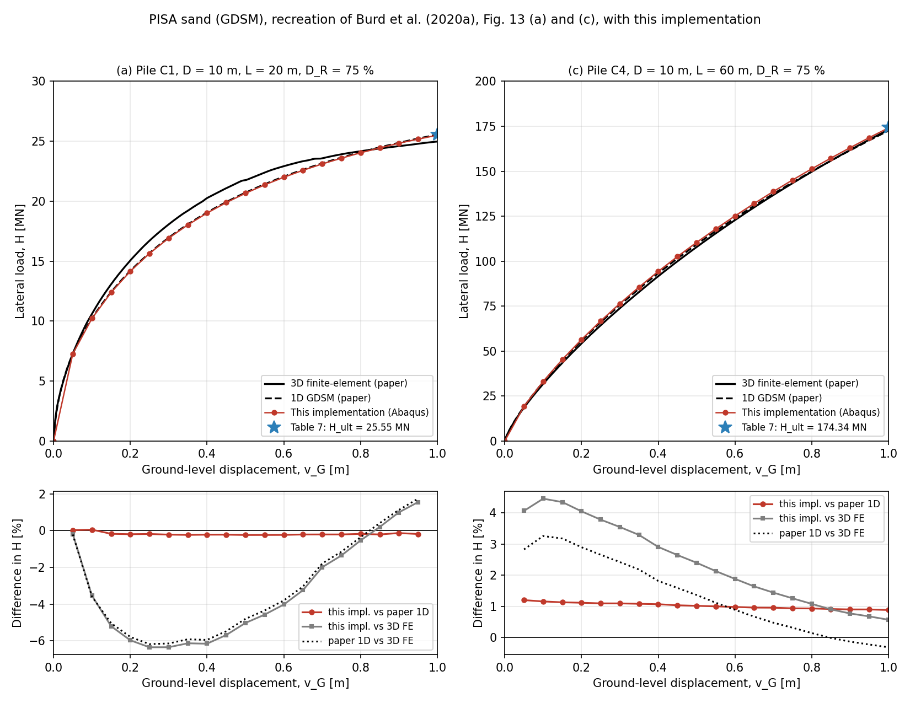

# Verification: PISA sand model (Burd et al. 2020)

Reference: Burd, H. J. et al. (2020). *PISA design model for monopiles for
offshore wind turbines: application to a marine sand.* Géotechnique 70(11),
1048–1066.

The paper gives exact values for its 1D design model (GDSM) in Table 7
(convergence study, piles C1 and C4, D_R = 75 %): the lateral load H_ult at
the ground-level displacement v_G = D/10 = 1 m and H_sd at
v_G = D/10 000 = 1 mm. As this implementation is the same 1D model, these
values can be compared directly.

**Result: all four reference values are reproduced within 0.2 %; all load
levels converged.**

| Pile | Value | This implementation | Table 7 (0.5 m elements) | Difference |
|---|---|---|---|---|
| C1 | H_ult at v_G = 1 m | 25.51 MN | 25.55 MN | −0.17 % |
| C4 | H_ult at v_G = 1 m | 174.10 MN | 174.34 MN | −0.14 % |
| C1 | H_sd at v_G = 1 mm | 0.5382 MN | 0.5385 MN | −0.06 % |
| C4 | H_sd at v_G = 1 mm | 0.7547 MN | 0.7556 MN | −0.12 % |

The values of this implementation are interpolated linearly to exactly
v_G = 1 m / 1 mm from the last load level (reached displacement within
0.06 % of the target).

## Settings

| Setting | Value |
|---|---|
| Spring model | `PISA_SAND` |
| Load control | displacement (`TARGET_DISPLACEMENT` = 1 m in 5 levels, or 1 mm in 1 level) |
| Load eccentricity | h = 50 m (`LEVER_ARM = 50`) |
| `DIAMETER_REFERENCE` | `"mid"`: D of the paper used as given (see "Pile diameter" below) |
| `SHEAR_FACTOR` | 0.5 (κ of the paper) |
| Material | `PISA_STEEL` (E = 200 GPa, ν = 0.3) |
| Element length | 0.5 m (C1: 40, C4: 120 elements) |
| `MAX_ITERATIONS` | 30 |

**Piles** (Table 4 of the paper):

| Pile | D [m] | L [m] | t [mm] | h [m] | L/D | Input |
|---|---|---|---|---|---|---|
| C1 | 10 | 20 | 91 | 50 | 2 | `pile_pisa_C1.csv` |
| C4 | 10 | 60 | 91 | 50 | 6 | `pile_pisa_C4.csv` |

**Soil** (`soil_pisa_dr75.csv`): Dunkirk sand, D_R = 75 %, γ' = 10.09 kN/m³,
G0 after Hardin & Black (eq. 7) with B = 875, e0 = 0.629, K0 = 0.4 (no φ
given, as in the paper).

## Load-displacement curves (Fig. 13)

To check the whole curve and not only the two reference points, Fig. 13 (a)
and (c) of the paper were recreated. The paper's curves (3D finite-element
calibration and 1D GDSM) were extracted from the vector graphics of the PDF
(page 14) and scaled with the axis ticks, so they are exact to well below
0.1 %; the extracted 1D curve of C1 ends at 25.553 MN at 1 m (Table 7:
25.551 MN). This implementation was run with 20 load levels of 0.05 m
(input folders `C1_curve`, `C4_curve`).

| Pile | This implementation vs. paper 1D curve (0.05 … 1.0 m) | At 1 m vs. Table 7 |
|---|---|---|
| C1 | −0.13 … −0.24 %, nearly constant | −0.17 % |
| C4 | +0.9 … +1.2 %, nearly constant | −0.17 % |

- **C1:** this implementation lies on the paper's 1D curve along the whole
  path. Its deviations from the 3D finite-element curve (up to −6 % at
  0.25–0.4 m) are those of the PISA model itself.
- **C4:** the offset of about +1 % comes from the figure: the paper's
  plotted 1D curve ends at 172.52 MN at 1 m, while its own Table 7 gives
  174.34 MN for the same model and pile (mesh effects are below 0.5 %
  according to Table 7). This implementation reaches 174.05 MN, i.e.
  −0.17 % from Table 7, the same deviation as for C1.
- The small-displacement range is not resolved by the 0.05 m steps; it is
  covered by the 1 mm comparison with Table 7 (−0.06 / −0.12 %).

Files in `Fig13_comparison/`: the plot, `Fig13_comparison.csv` (deviation
per load level), `paper_Fig13_*.csv` (extracted curves of the paper),
`this_implementation_*_pile_head.csv` (the runs) and `plot_fig13.py`
(recreates the plot with `abaqus python plot_fig13.py`, from the results of
the `C1_curve`/`C4_curve` runs if they exist).

## Pile diameter

The PISA papers use one diameter D (their pile tables) both for the
thin-walled section properties (I = πD³t/8, A = πDt) and for the
normalisation of the soil reaction curves. `DIAMETER_REFERENCE = "mid"` does
exactly this with D from pile.csv: the Abaqus pipe gets the outer radius
D/2 + t/2, which gives A = πDt and the thin-walled I (difference below
0.01 %), and the reaction curves use D. With `"outer"` (D treated as the
outer diameter, mean diameter D − t), the results are clearly further from
Table 7:

| Pile | Value | `"mid"` | `"outer"` |
|---|---|---|---|
| C1 | H at 1 mm | −0.06 % | −1.2 % |
| C4 | H at 1 mm | −0.12 % | −1.6 % |
| C1 | H at 1 m | −0.17 % | −1.2 % |
| C4 | H at 1 m | −0.14 % | −1.6 % |

## Load levels

| Run | v_G target [m] | H [MN] | v_G reached [m] | Iterations |
|---|---|---|---|---|
| C1_ultimate | 0.2 / 0.4 / 0.6 / 0.8 / 1.0 | 14.16 / 19.01 / 21.99 / 24.04 / 25.51 | 0.2001 / 0.4000 / 0.5994 / 0.7999 / 1.0004 | 13 / 8 / 9 / 7 / 6 |
| C4_ultimate | 0.2 / 0.4 / 0.6 / 0.8 / 1.0 | 56.41 / 94.23 / 125.13 / 151.31 / 174.05 | 0.2000 / 0.3997 / 0.5999 / 0.7998 / 0.9995 | 7 / 5 / 5 / 4 / 5 |
| C1_small_displacement | 0.001 | 0.5379 | 0.0009994 | 8 |
| C4_small_displacement | 0.001 | 0.7553 | 0.0010008 | 7 |

Every iteration is one Abaqus run in which both the load H (displacement
control) and the distributed moment springs (iterative PISA model) are
updated. C1 is close to its capacity at 1 m (flat load-displacement curve),
which makes it a demanding test of the displacement control.

## Remarks

- Remaining differences of 0.1–0.2 % come from the discretisation: here the
  soil reactions are lumped into springs at the nodes and the pile is an
  Abaqus B31 Timoshenko beam; the paper uses soil elements with Hermite
  interpolation and four Gauss points per element.
- The calibration of the GDSM (Table 6), the conic function (eqs. 2–5) and
  G0 (eq. 7) were also checked term by term against the paper.
- The verification revealed a weakness of the displacement control for
  iterative spring models (bounds of the load from earlier runs became
  invalid when the springs changed, C1 did not converge at 1 m). It was
  fixed before these results were produced; see the calculation method in
  the documentation.

## Input and result files

| Run | Input folder | Result folder |
|---|---|---|
| C1, 1 m | `Inputs/Verification/PISA_Verification/C1_ultimate` | `C1_ultimate/` |
| C4, 1 m | `Inputs/Verification/PISA_Verification/C4_ultimate` | `C4_ultimate/` |
| C1, 1 mm | `Inputs/Verification/PISA_Verification/C1_small_displacement` | `C1_small_displacement/` |
| C4, 1 mm | `Inputs/Verification/PISA_Verification/C4_small_displacement` | `C4_small_displacement/` |
| C1, curve (20 levels) | `Inputs/Verification/PISA_Verification/C1_curve` | `C1_curve/` (run results summarised in `Fig13_comparison/`) |
| C4, curve (20 levels) | `Inputs/Verification/PISA_Verification/C4_curve` | `C4_curve/` (as above) |

Each input folder contains `Input.py`, `AdvancedSettings.py` and the CSV
files; run it with `run_abaqus.bat <input folder>`. Each result folder
contains `progress.log` and `<pile>/<soil>/PISA_Sand/` with the `.odb`,
`.cae`, `pile_head.csv`, `pile_profile.csv` and the plots.
